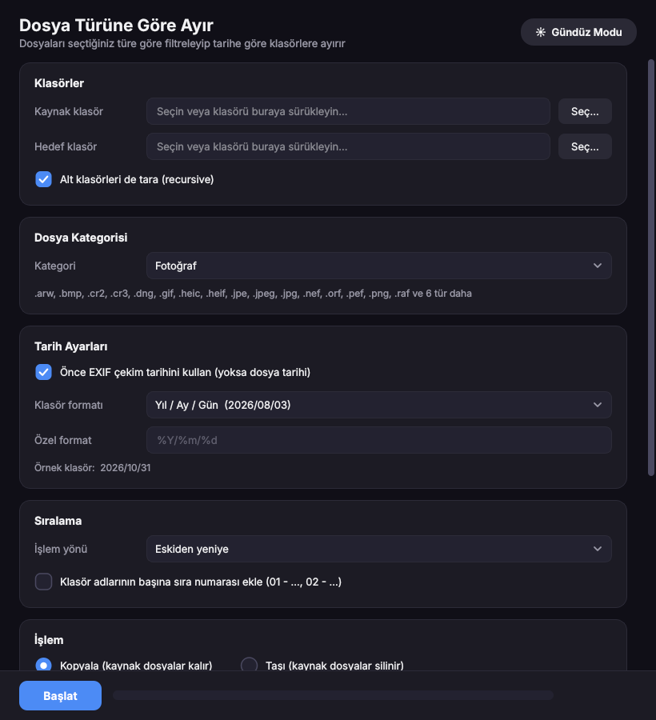
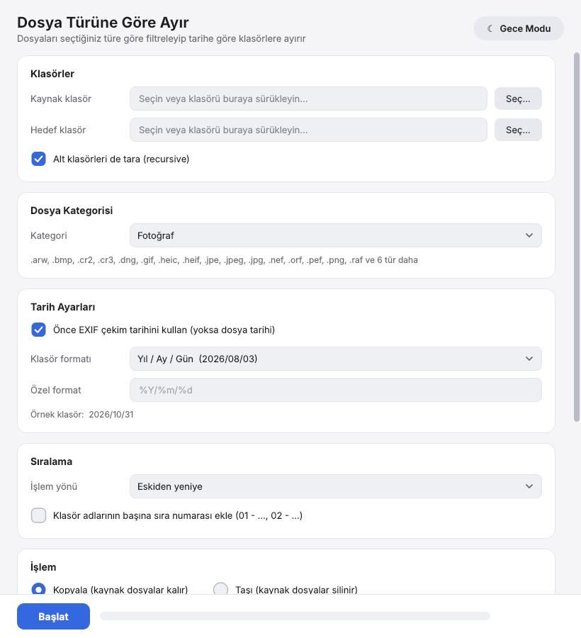

# Dosya Türüne Göre Ayır 🗂️

*(English below)*

Bir klasördeki dosyaları **seçtiğiniz türe** göre filtreleyip (fotoğraf, görsel,
3D baskı dosyası, video, belge, arşiv, kod… veya tüm dosyalar), çekim/dosya
tarihine göre otomatik olarak klasörlere ayıran, gece/gündüz temalı bir
masaüstü uygulaması. **PySide6 (Qt)** ile yazılmıştır.

[**Foto Tarihe Göre Ayır**](https://github.com/BuRsTFiRe47/foto-tarihe-gore-ayir)
projesinin genel amaçlı fork'udur — aynı tarih motorunu korur, ama yalnızca
fotoğraflara değil, seçtiğiniz herhangi bir dosya türü grubuna uygulanır.


<p>
  
  
</p>

## Özellikler

- 🗂️ **Dosya kategorisi seçimi** — Fotoğraf, Görsel (Tasarım/Grafik), Görsel + Fotoğraf,
  3D Baskı Dosyaları, Video, Ses, Belgeler, Arşivler, Kod/Geliştirici Dosyaları,
  E-posta veya Tüm Dosyalar
- 📅 EXIF çekim tarihi veya dosya değiştirilme tarihine göre ayırma
  (EXIF yalnızca fotoğraf türlerinde kullanılır; diğer kategorilerde kutu otomatik pasifleşir)
- 🗓️ Hazır tarih formatları (Yıl/Ay/Gün, Yıl-Ay, sadece Yıl, Türkçe ay adı…) veya
  kendi `strftime` formatınız — altında **canlı örnek klasör adı** görünür
- 📁 `/` ile alt klasör oluşturma (örn. `%Y/%m` → `2026/08`)
- 🔢 Klasör adlarına sıra numarası ekleme (alfabetik sıralamayı garanti eder)
- ↔️ Kopyala veya taşı (taşırken onay sorar)
- 👀 Önizleme (dry-run) modu — hiçbir dosyaya dokunmadan sonucu görün
- ⏹️ İşlemi **Durdur** düğmesiyle istediğiniz an kesebilirsiniz
- 🧲 Klasörü pencereye **sürükleyip bırakarak** seçebilirsiniz
- 🔁 Aynı klasörü tekrar çalıştırmak güvenlidir: hedefte zaten aynısı olan dosyalar
  atlanır, hedef klasör tekrar taranmaz (`(1)` kopyaları oluşmaz)
- 🌙☀️ Gece / Gündüz modu (varsayılan: gece, seçiminiz hatırlanır)

## Kategoriler ve uzantıları

| Kategori | Uzantı örnekleri |
|---|---|
| Fotoğraf | jpg, png, heic, tiff, cr2, nef, arw, dng, raw… |
| Görsel (Tasarım/Grafik) | svg, ai, eps, psd, ico, sketch, fig, cdr… |
| Görsel + Fotoğraf | yukarıdaki ikisinin birleşimi |
| 3D Baskı Dosyaları | stl, obj, 3mf, gcode, step, ply, blend… |
| Video | mp4, mov, avi, mkv, webm, flv… |
| Ses | mp3, wav, flac, aac, m4a… |
| Belgeler | doc(x), xls(x), ppt(x), pdf, odt, txt, csv… |
| Arşivler | zip, rar, 7z, tar, gz, iso… |
| Kod / Geliştirici Dosyaları | py, js, ts, html, css, json, java, go… |
| E-posta | pst, eml, msg, mbox… |
| Tüm Dosyalar | filtre yok — her dosya |

Kendi kategorinizi eklemek için `dosya_turune_gore_ayir.py` içindeki `CATEGORIES`
sözlüğüne yeni bir uzantı kümesi eklemeniz yeterli.

## İndirme (kurulum gerektirmez)

En güncel derlenmiş sürümleri **[Releases](https://github.com/BuRsTFiRe47/dosya-turune-gore-ayir/releases)**
sayfasından indirebilirsiniz:

- **Windows** → `DosyaTuruneGoreAyir.exe`
- **Mac (Apple Silicon / M1, M2, M3, M4…)** → `DosyaTuruneGoreAyir-macOS-AppleSilicon.zip`

> Not: Uygulama Qt kütüphanelerini içerdiği için dosya boyutu büyüktür (yaklaşık 100 MB).
> Intel Mac için ayrı derleme yoktur; "Kaynaktan çalıştırma" ile çalıştırabilirsiniz.

Bu dosyalar benim bilgisayarımda değil, **GitHub Actions üzerinde bu repodaki kaynak
koddan otomatik olarak** derlenir — adımları ve günlükleri
[Actions](https://github.com/BuRsTFiRe47/dosya-turune-gore-ayir/actions) sekmesinden herkes görebilir.

**macOS ilk açılış:** `.zip` dosyasını açın, `DosyaTuruneGoreAyir.app` üzerinde **sağ tık → Aç**,
çıkan uyarıda tekrar **Aç** deyin.
**Windows ilk açılış:** SmartScreen uyarısında **Ek bilgi → Yine de çalıştır**.

## Kaynaktan çalıştırma

```bash
pip install PySide6 pillow
python dosya_turune_gore_ayir.py
```

## Kendi exe/app dosyanızı derlemek

```bash
pip install PySide6 pillow pyinstaller

# Windows
pyinstaller --onefile --noconsole --name "DosyaTuruneGoreAyir" dosya_turune_gore_ayir.py

# macOS
pyinstaller --windowed --name "DosyaTuruneGoreAyir" dosya_turune_gore_ayir.py
```

> PyInstaller çapraz derleme yapamaz; her platformun paketini o platformda (ya da
> bu repodaki GitHub Actions ile) derlemeniz gerekir.

## Yeni sürüm yayınlamak

```bash
git tag v1.0.0
git push origin v1.0.0
```

Windows exe ve Apple Silicon `.app` otomatik derlenip bir GitHub Release'e eklenir.

## Lisans

MIT — bkz. [LICENSE](LICENSE)

---

## English

A dark/light-themed desktop app (built with **PySide6 / Qt**) that filters files in a
folder by a **chosen type** (photo, image/design, 3D-print file, video, document,
archive, code… or all files) and sorts them into date-based folders using the capture
date (EXIF) or file date.

A general-purpose fork of [**Foto Tarihe Göre Ayır**](https://github.com/BuRsTFiRe47/foto-tarihe-gore-ayir)
("Sort Photos by Date") — same date engine, but applicable to any file-type group.

### Features

- 🗂️ **Category picker** — Photo, Image (Design/Graphics), Image + Photo, 3D-Print Files,
  Video, Audio, Documents, Archives, Code, Mail, or All Files
- 📅 EXIF capture date or file modified date (EXIF checkbox disables itself for
  non-photo categories)
- 🗓️ Built-in date-folder formats or a custom `strftime` pattern, with a **live example
  folder name**
- 📁 Nested subfolders via `/` (e.g. `%Y/%m` → `2026/08`)
- 🔢 Optional sequence-number prefix on folder names
- ↔️ Copy or move (asks for confirmation before moving)
- 👀 Dry-run preview, ⏹️ **Stop** button, 🧲 drag & drop folders onto the path fields
- 🔁 Safe to re-run: files already present at the destination are skipped and the
  destination folder is not re-scanned (no `(1)` duplicates)
- 🌙☀️ Dark / Light mode (defaults to dark, your choice is remembered)

### Download

Get builds from **[Releases](https://github.com/BuRsTFiRe47/dosya-turune-gore-ayir/releases)**:
Windows `DosyaTuruneGoreAyir.exe`, Mac (Apple Silicon) `DosyaTuruneGoreAyir-macOS-AppleSilicon.zip`.
They are built by **GitHub Actions straight from this repo's source** — logs are public under
[Actions](https://github.com/BuRsTFiRe47/dosya-turune-gore-ayir/actions). The files are large
(~100 MB) because they bundle Qt.

### Run from source

```bash
pip install PySide6 pillow
python dosya_turune_gore_ayir.py
```

### License

MIT — see [LICENSE](LICENSE)
